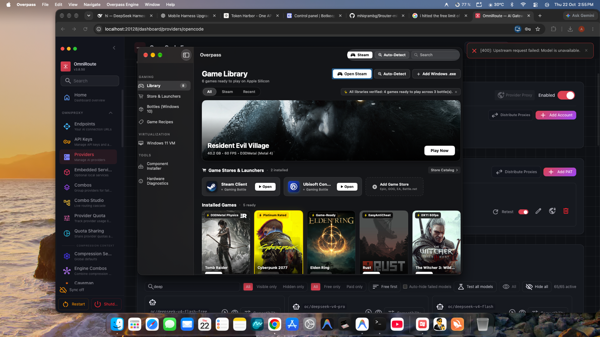

#  Overpass for Mac

> **The Free, Premium Windows Gaming & Compatibility Suite for macOS Apple Silicon (M1–M4)**  
> *A high-performance, unified, zero-cost alternative to CrossOver and Parallels Desktop.*

<p align="center">
  <a href="https://github.com/Akshat-lab886/Overpass/releases/latest">
    
  </a>
</p>

<p align="center">
  
  
  
  
  
</p>

---

## 📸 The Interface

<p align="center">
  
</p>

---

## ⚡ What is Overpass?

**Overpass** bridges the gap between Windows PC games and macOS on Apple Silicon without requiring expensive ongoing subscriptions ($70+/year for CrossOver or $100+/year for Parallels). 

Engineered natively in Swift and Metal for macOS Sequoia, Overpass combines the low-overhead speed of **Wine translation** (translating Windows x86_64 DirectX calls directly to Apple Metal 3) with **Apple Native Virtualization** (`Virtualization.framework`) for full Windows 11 ARM64 environments.

```
       ┌────────────────────────────────────────────────────────┐
       │                   Overpass for macOS                   │
       └──────────────────────────┬─────────────────────────────┘
                                  │
         ┌────────────────────────┴────────────────────────┐
         │                                                 │
  [ High-FPS Gaming ]                              [ Virtualization ]
  Wine 11.0 / CrossOver 26 Core                    macOS Virtualization.framework
  • D3DMetal (Apple GPTK 2 DirectX to Metal)       • Windows 11 ARM64 VM
  • DXVK 2.3 + MoltenVK Vulkan translation         • VirtIO High-Speed Storage
  • MSync / ESync Mach kernel synchronization      • Shared folder host mounts
  • Direct Steam, Epic, Ubisoft, GOG launcher      • USB mass storage boot
```

---

## 🌟 Key Features

### 🎮 Dual Graphics Translation Pipeline
- **Apple D3DMetal (GPTK 2):** Translates DirectX 11 and DirectX 12 API calls directly to Apple Metal 3, enabling hardware ray-tracing and full shader execution on M3 and M4 Apple Silicon GPUs.
- **DXVK & MoltenVK:** Proven translation layer for DirectX 9, 10, and 11 titles via Vulkan and Metal.
- **Metal HUD:** Real-time in-game display of FPS, frame-time graphs, GPU utilization, and unified memory pressure.
- **MSync Synchronization:** Uses native Darwin Mach semaphores for stutter-free frame delivery and low input latency.

### 🛍️ Game Stores & Launchers Shelf
Directly detects and manages Windows game launchers installed inside your gaming bottles:
- **Steam Client for Windows:** Automatic detection and 1-click launch with DPI scaling and font smoothing.
- **Ubisoft Connect:** Dedicated bottle paths with direct execution support.
- **Epic Games Launcher & GOG Galaxy:** Automated bottle environment tuning.
- **Live Status Indicators:** Real-time indicators showing whether a store launcher is currently running or ready to open.

### 🔍 Auto Game Detection & Steam Integration
- Automatically reads Steam library manifests (`appmanifest_*.acf`) from your bottles.
- Instantly detects installed games and adds them to your dashboard.
- Displays games ready to play with authentic cover artwork, playtime, and graphics badges.
- Dynamic search and filter pills (*All Games*, *Steam*, *Recent*).

### 🎯 Pre-Tuned Performance Recipes
Out-of-the-box profiles tuned for popular PC titles:
- **The Witcher 3: Wild Hunt (Next-Gen & DX11):** Pre-configured with direct launcher bypass, D3DMetal graphics, and Media Foundation video codec support.
- **Cyberpunk 2077:** Tuned for D3DMetal, MSync, and high-performance AVX2 instructions.
- **Elden Ring:** Anti-cheat offline compatibility mode and shader pre-compilation.
- **Baldur's Gate 3:** Native Vulkan/D3DMetal tuning with HDR support.
- **Tomb Raider & Resident Evil Village:** High-FPS DirectX 11/12 profiles with 60 FPS lock.

### 🖥️ Native Apple Virtualization
- Built using Apple's official `Virtualization.framework` (`VZVirtualMachine`).
- Run a full **Windows 11 ARM64** desktop alongside macOS with native CPU performance.
- VirtIO networking, accelerated storage, and shared host directories.

### 🚀 Standalone macOS `.app` Generator
Convert any Windows `.exe` into a native macOS application bundle in `~/Applications/Overpass/`. Launch games straight from Spotlight (`⌘ Space`), Launchpad, or the macOS Dock with custom Retina icons.

---

## 📥 Download & Installation

### 1. Download the Installer
Download the latest disk image from GitHub Releases or from this repository:
- **[Download Overpass-1.0.0.dmg](https://github.com/Akshat-lab886/Overpass/releases/download/v1.0.0/Overpass-1.0.0.dmg)** *(Direct Download, 5.5 MB)*
- Or download directly from the repository root: [`Overpass-1.0.0.dmg`](Overpass-1.0.0.dmg)

### 2. Install to Applications
1. Open the downloaded `Overpass-1.0.0.dmg`.
2. Drag **Overpass.app** into the **Applications** shortcut.
3. Launch **Overpass** from Launchpad or `/Applications`.

```
+-------------------------------------------------------+
|  Overpass Installer                                   |
|                                                       |
|    [ Overpass.app ]  ---------->  [ Applications ]    |
|                                                       |
+-------------------------------------------------------+
```

> **Note on First Launch:** If macOS displays an *unidentified developer* security prompt, go to **System Settings → Privacy & Security** and click **Open Anyway**.

---

## 💻 System Requirements

| Component | Minimum Requirement | Recommended |
| :--- | :--- | :--- |
| **Processor** | Apple Silicon M1 (8-core) | M2, M3, or M4 (Pro / Max / Ultra) |
| **Operating System** | macOS Sonoma 14.0+ | macOS Sequoia 15.0+ |
| **Unified Memory** | 8 GB RAM | 16 GB+ for AAA gaming |
| **Storage** | 300 MB for Overpass app | SSD storage for game installs |
| **Architecture** | Apple Silicon ARM64 | Apple Silicon ARM64 |

---

## 🛠️ Command-Line Utility (`overpass`)

Overpass includes a fast command-line interface for scripting and terminal management:

```bash
# Check system environment, Rosetta 2, and Metal status
overpass status

# List all bottles
overpass bottle list

# Run any Windows executable in a specific bottle
overpass run "Gaming" "C:\Games\Cyberpunk 2077\bin\x64\Cyberpunk2077.exe"

# Install essential stores or runtime components
overpass store install steam
overpass component install dxvk
```

---

## 🔒 Distribution & Licensing Notice

- **Overpass Application:** Distributed as free-to-use compiled freeware binary for macOS. The source code of Overpass UI and management orchestration is private and proprietary.
- **Third-Party Compatibility Runtimes:** Overpass orchestrates open-source runtime components including Wine (LGPL), DXVK (zlib/libpng), and MoltenVK (Apache 2.0). All third-party software remains subject to their respective upstream licenses.

---

<p align="center">
  <sub>Overpass — Built with passion for Apple Silicon gaming.</sub>
</p>
